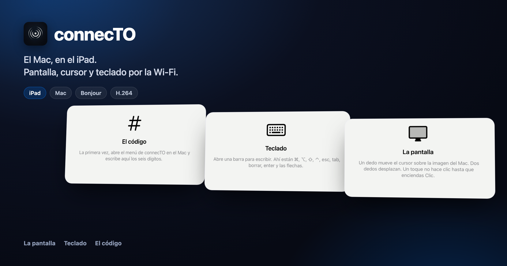

# connecTO

Control a Mac from an iPad on the same Wi-Fi: the screen, the pointer, and the keyboard.

The screens inside the app are in Spanish. The names below are what you will see.

## How it works

connecTO is two apps that talk only on the local network.

1. **connecTOMac** runs in the menu bar. It advertises the Mac with Bonjour (`_connecto._tcp`) and, once an iPad is paired, captures the display as H.264 and injects the pointer, clicks, keys, and media keys.
2. **connecTO** on the iPad browses for that Mac, pairs, and shows the picture. Touch on the picture moves the Mac pointer.

The first time an iPad connects, the Mac shows a 6-digit code in the menu bar. The code lasts 3 minutes, then the Mac replaces it. After a correct code, that iPad is trusted and later connections skip the code. Trust is stored on the Mac in `~/Library/Application Support/connecTO/trusted-devices.json`. **Olvidar iPads** deletes it.

One iPad controls the Mac at a time. There is no account and no connection off the local network.

## What you need

- A Mac on macOS 15 or later
- An iPad or iPhone on iOS 18 or later, on the **same Wi-Fi** as the Mac
- Xcode, to build both apps

The iOS Simulator on that same Mac can see the menu-bar app. A physical iPad on the Wi-Fi is the setup this is for.

## Run it

Open `connecTO.xcodeproj`. Start the Mac app first. The iPad has nothing to list until the Mac is advertising.

### 1. Start the Mac

1. Select the **connecTOMac** scheme.
2. Set the run destination to **My Mac**.
3. Press Run.

The app does not appear in the Dock. Look in the menu bar for a radio-waves icon. It changes to an iPad icon while a device is linked. Click that icon to open the menu.

The first launch asks for Accessibility. Allow it. Without that permission the Mac ignores the pointer, clicks, and keys.

### 2. Allow Screen Recording

Open the menu-bar icon. If it says **Falta Grabación de pantalla**, click **Abrir Ajustes de Grabación** and turn connecTOMac on. Quit and run the Mac app again if the picture still does not appear. Without Screen Recording the iPad can still send pointer input, but it will not show the desktop.

Also allow Local Network if macOS asks. That is what lets the iPad find the Mac.

### 3. Start the iPad

1. Select the **connecTO** scheme.
2. Set the destination to your iPad, iPhone, or a simulator.
3. Press Run.
4. When iOS asks, allow Local Network.

The iPad opens on **connecTO** and lists Macs running the menu-bar app. **Ningún Mac a la vista** means the Mac app is not running, or the two devices are not on the same Wi-Fi.

### 4. Pair

1. On the iPad, tap the Mac’s name.
2. On the Mac, click the menu-bar icon and read the 6 digits under **Código**.
3. Type those digits on the iPad. It sends them as soon as the sixth digit is in.

**Ese código no coincide** means the digits are wrong. **Ese código ya venció** means the 3 minutes passed: read the new code in the menu. **Nuevo código** replaces it immediately.

The next time, open both apps. A trusted iPad reconnects to the last Mac on its own.

## Where to change things

| What | Where |
| --- | --- |
| Pairing code, link status, quit | Mac menu bar → connecTO icon |
| New code before the old one expires | Menu → **Nuevo código** |
| Forget every paired iPad | Menu → **Olvidar iPads** |
| Accessibility (pointer, clicks, keys) | Menu → **Abrir Ajustes de Accesibilidad**, or System Settings → Privacy & Security → Accessibility → connecTOMac |
| Screen Recording (the picture) | Menu → **Abrir Ajustes de Grabación**, or System Settings → Privacy & Security → Screen Recording → connecTOMac |
| Local Network | System Settings → Privacy & Security → Local Network, on the Mac and on the iPad |
| Picture size | iPad, while connected → sparkles icon. Long side from 960 to 3840 px, default 1920. More pixels look sharper and use more of the network. |
| How the controls work | iPad → **?** in the top corner (**Cómo se usa**) |
| Switch desktop or show all windows | System Settings → Keyboard → Keyboard Shortcuts → Mission Control. The iPad sends Control–Left, Control–Right, and Control–Up. **Ventanas** a second time sends Control–Down. If those shortcuts are off, **Anterior**, **Ventanas**, and **Siguiente** do nothing. |

## On the iPad, once you are in

The picture is the Mac’s screen.

- One finger moves the pointer. A tap does **not** click until **Clic** is on (it turns orange). Tap **Clic** again to turn it off.
- Two fingers scroll the Mac. Pinch to zoom the picture, pinch closed to zoom out, and move both fingers together to look around the magnified image.
- Sliding a finger on a Magic Mouse scrolls up, down, or sideways.
- **Clic derecho** right-clicks where the pointer already is.
- **Arrastrar** (orange) holds the button down while your finger is on the picture. **Clic** and **Arrastrar** are never both on.
- **Teclado** opens a bar with ⌘ ⌥ ⇧ ⌃, esc, tab, delete, return, and the arrows. Text you type is sent to the Mac.
- **Anterior** and **Siguiente** move one desktop left or right. They send Control with the arrow, so a video does not seek. **Ventanas** opens Mission Control (Control–Up); tap it again for the current app’s windows (Control–Down).
- The display button chooses which monitor is shown. The pointer lands on that screen.
- **Sonido** plays on the Mac, or on the iPad. While it plays on the iPad, the Mac output is muted and comes back when you choose **En el Mac**.
- Volume, mute, and playback sit in the same row as the other controls. Every control is the same size and shows only its icon. Scroll that row sideways if they do not fit.
- **Desconectar** is the last control in that row. The icon and its background are red. It asks before it returns to the Mac list.

If the Mac is not sharing the screen, the iPad says so and falls back to a trackpad until Screen Recording is on.
