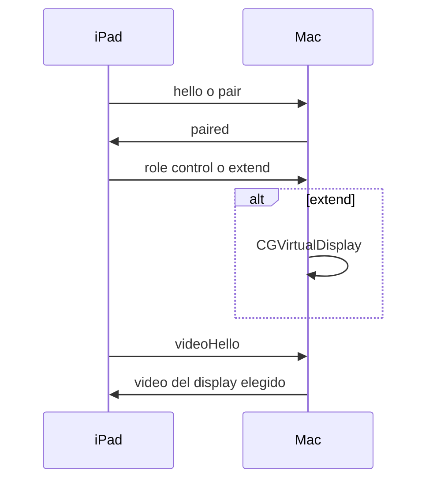

# Monitor virtual

El iPad podrá elegir, al conectar, entre dos modos:

- **Controlar el Mac.** Lo que la app hace hoy: muestra un monitor que el Mac ya tiene y manda el cursor, los clics y el teclado.
- **Monitor externo.** El Mac crea un display virtual, lo trata como un monitor de más y manda solo esa imagen al iPad. Las ventanas se arrastran hasta él. Al desconectar, el display desaparece.

Este documento es el plan. Las cuatro fases ya están en el código. Cada fase compila y se prueba sola.

## Cómo está hoy

1. El iPad lista los Mac en `connecTO/Features/Discover/DiscoverView.swift`. Al tocar uno, `SessionClient.connect(to:)` abre la sesión.
2. Tras `paired`, `SessionClient.apply` manda `quality` y abre el canal de vídeo. En ese canal manda `videoHello`.
3. `SessionServer.acceptVideoHello` llama a `beginCapture`. `ScreenCapturer.start` elige un display de `SCShareableContent`, guarda `CGDisplayBounds` y captura a 30 fps (`minimumFrameInterval` de 1/30).
4. El iPad puede pedir otro monitor físico con `screen`. `SessionMachine` solo acepta ese mensaje, y `quality` y `audio`, cuando la fase ya es `.paired`.
5. Un toque se convierte en un punto de ese rectángulo con `ScreenMapping.globalPoint`. `EventInjector` publica el evento ahí.

El botón de pantalla del iPad solo cambia entre monitores que macOS ya tiene. Para arrastrar una ventana al iPad, WindowServer tiene que ver un display nuevo.



## El mensaje

En `Shared`, un modo y un mensaje nuevo:

```swift
enum LinkMode: String, Codable, Equatable, Sendable {
    case control
    case extend
}
```

`WireMessage` gana `case role(LinkMode)`. El JSON sigue el estilo de los demás `type`:

```json
{"type":"role","mode":"extend"}
```

`mode` es `"control"` o `"extend"`. Hay que añadirlo en los dos `switch` de `Shared/WireMessage.swift`: el `default` del decodificador rechaza un tipo desconocido y cierra la conexión.

`SessionMachine.handle` lo trata como `screen` y `audio`:

- Antes de `.paired`, responde `.rejected(.notPaired)`.
- Con la sesión abierta, devuelve `.input`.

Un iPad que aún no pasó el código no puede pedir el monitor. `ProtocolVersion.current` se queda en 1: es un mensaje nuevo dentro de la misma versión, y las dos apps se actualizan juntas.

La resolución no viaja en el mensaje. El primer display virtual usa un tamaño fijo (abajo, en la fase 2).

## Dónde se recuerda la elección

`SessionClient.reconnectIfNeeded` vuelve al último Mac guardado en `connecTO.lastMacName`. La fase 3 guarda el modo al lado, con una clave propia, y lo reenvía en cada `paired`. Cambiar de modo es volver a la lista y elegir el otro.

## Fase 1 — Contrato

Objetivo: las dos apps hablan `role` y los tests lo cubren. El Mac guarda el modo y sigue capturando el monitor físico. Así se prueba el protocolo sin crear un display.

Archivos:

- `Shared/WireMessage.swift`: el enum `LinkMode`, el caso `role`, y la clave `mode`.
- `Shared/SessionMachine.swift`: aceptar `role` solo en `.paired`.
- `connecTOMac/SessionServer.swift`: en el `switch` de `.input`, guardar el modo. Hoy todo lo que no es `quality`, `screen` o `audio` cae en `injector.apply`; `role` no puede caer ahí. `closeLink` vuelve el modo a `control`.
- `connecTOTests/WireMessageTests.swift`: ida y vuelta por `FrameCodec`, junto a `screen` y `audio`.
- `connecTOTests/SessionMachineTests.swift`: `role` antes de emparejar se rechaza; después de emparejar es `.input`.

Prueba de cierre: `connecTOTests` pasa. Un `extend` de esta fase no crea pantalla y la captura sigue en el display físico.

## Fase 2 — Display en el Mac

Objetivo: si el rol de la sesión es `extend`, el Mac crea un display virtual, lo captura y lo destruye al cerrar.

`CGVirtualDisplay`, `CGVirtualDisplayDescriptor`, `CGVirtualDisplayMode` y `CGVirtualDisplaySettings` están en el `CoreGraphics.tbd` del SDK (macOS 15 es el deployment target de connecTOMac). Ese SDK no trae el header. El primer trabajo de esta fase es declarar esas cuatro clases en un header local, junto al wrapper, y comprobar los selectores contra el binario de CoreGraphics antes de llamarlos.

Archivo nuevo `connecTOMac/VirtualDisplay.swift`. Las carpetas del proyecto están sincronizadas, así que no hay que tocar `project.pbxproj`.

El wrapper:

- Crea el display con nombre `connecTO`.
- Modo inicial fijo, apaisado, proporción 4:3: 2048×1536 px, 60 Hz, HiDPI. El número vive en una constante de ese archivo.
- Publica el `displayID` y el `CGDisplayBounds` cuando el display ya aparece en `SCShareableContent`.
- Se suelta en `deinit` para que el monitor desaparezca.

`SessionServer.beginCapture` lo usa solo si el rol es `extend`: crea el display, pasa ese `displayID` a `ScreenCapturer.start` y captura ese. `preferredDisplayID` de un `screen` anterior no puede ganar. En `control`, `beginCapture` sigue igual que ahora.

Hay dos conexiones TCP. `role` va por la de control y `videoHello` por la de vídeo, así que `videoHello` puede llegar primero. `beginCapture` espera a tener el `role` de esta sesión. Si el vídeo está listo y el rol todavía no, se queda parado hasta el mensaje.

`closeVideo` y `closeLink` sueltan el display. `restartCapture` (cambio de nitidez o de audio) lo conserva y vuelve a capturar el mismo id.

`ScreenCapturer` acepta un intervalo de frame. En `extend` es 1/60. En `control` se queda en 1/30. `showsCursor` sigue en true: el cursor del Mac se ve en la imagen cuando entra en ese display.

`SessionServer.publish` cambia el texto que `MacHost.linkLabel` muestra en `connecTOMac/MenuStatusView.swift` cuando el rol es `extend`, para que el menú diga que ese iPad está de monitor.

Si el display no se crea, o no aparece entre los displays capturables, el Mac manda `screenUnavailable` y cierra el vídeo, que es el camino que el iPad ya enseña.

Prueba de cierre: con un iPad que ya manda `extend` (aunque la fase 3 aún no tenga botones, se puede forzar el mensaje), Ajustes del Sistema muestra el monitor `connecTO` mientras dura la sesión y deja de mostrarlo al desconectar. La imagen del iPad es ese display, vacío de ventanas hasta que se arrastra una.

## Fase 3 — Elección en el iPad

Objetivo: la persona elige el modo antes de conectar, y el iPad lo manda solo.

Tras tocar un Mac en `DiscoverView`, y antes de `SessionClient.connect(to:)`, dos acciones: **Controlar el Mac** y **Monitor externo**. `RootView` guarda la elección y se la pasa a `connect`.

En `SessionClient.apply`, el caso `.paired` manda `role` y después `quality`, y entonces llama a `openVideo`. El modo también se guarda para `reconnectIfNeeded`.

En `ControlView`, con el modo `extend`, el menú de pantalla no ofrece los monitores físicos. El de `control` sigue listando `client.displays`.

Textos:

- Una lección en `connecTO/Features/Guide/ControlGuide.swift`. `connecTOTests/ControlGuideTests.swift` compara la lista exacta de `id`, así que el id nuevo entra en ese array.
- Una frase en el README que distinga los dos modos.

Prueba de cierre: desde la lista se abre cada modo. Controlar muestra el escritorio físico y deja cambiar de monitor. Monitor muestra el display virtual y el selector de pantallas no cambia la captura a otro monitor.

## Fase 4 — Que se use como un monitor

Objetivo: el cursor del Mac puede cruzar al iPad, y el dedo del iPad cae en ese mismo display.

Al crear el display, colocarlo a la derecha del principal: origen en `(maxX, minY)` del `CGDisplayBounds` de `CGMainDisplayID()`, con `CGBeginDisplayConfiguration`, `CGConfigureDisplayOrigin` y `CGCompleteDisplayConfiguration`.

El toque no necesita otro mapeo. `EventInjector.moveAbsolute` ya usa el `displayFrame` que `beginCapture` guardó, y `ScreenMapping.globalPoint` lo convierte. En este modo ese rectángulo es el del display virtual.

Mientras el rol sea `extend`, `SessionServer.applyScreen` ignora un `displayID` que no sea el virtual, para que un mensaje viejo no pase la captura al monitor físico.

Límites que se quedan así:

- Es un monitor virtual más un vídeo H.264, con la latencia de esa cadena. A 60 fps solo en este modo.
- El contenido protegido puede salir en negro, igual que en la captura actual.
- Sigue haciendo falta Grabación de pantalla para ver la imagen y Accesibilidad para el cursor, los clics y el teclado.
- Sigue habiendo un iPad a la vez, así que hay un solo display virtual.

Prueba de cierre: con el modo monitor, una ventana arrastrada más allá del borde derecho del Mac aparece en el iPad, y un toque en esa ventana hace clic en ella. Al desconectar, la ventana vuelve al escritorio físico porque el display ya no existe.
